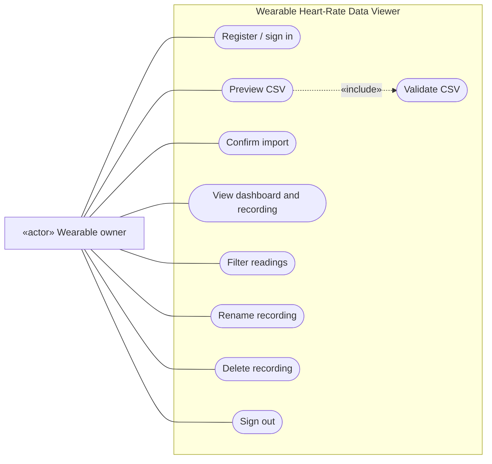
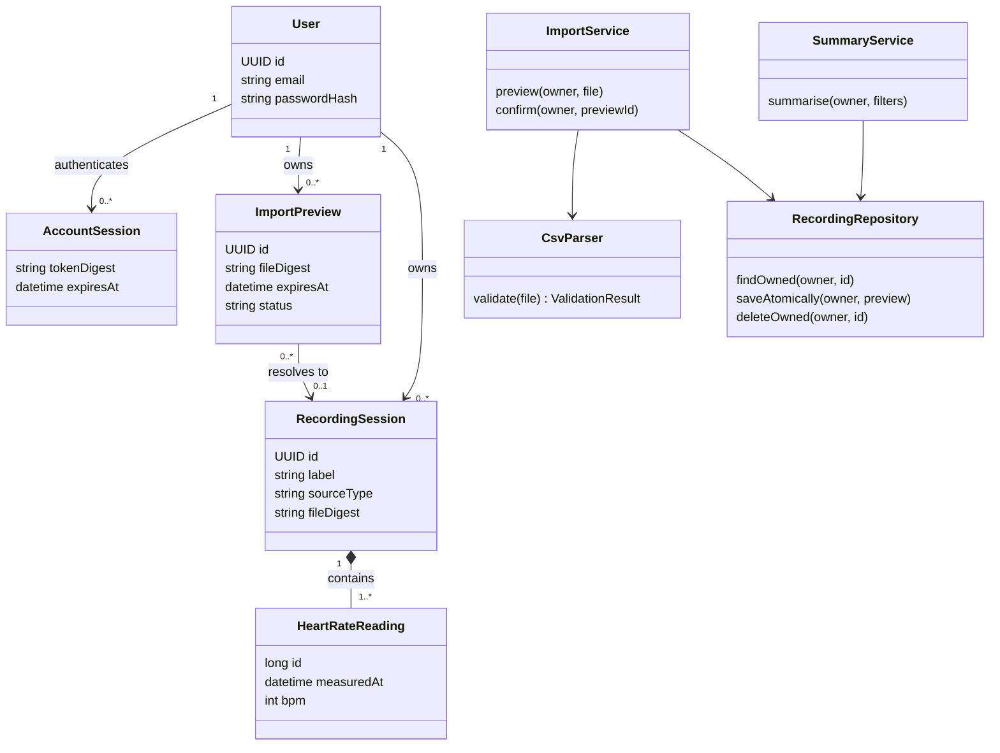
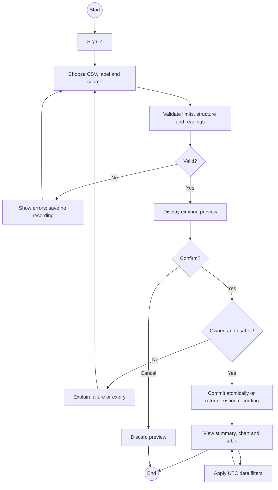

# UML model set

**Status:** Draft design, not reverse-engineered implementation. Actor: registered wearable owner. The assessor uses the same user flows with synthetic data.

## Use-case model

Mermaid does not provide a native UML use-case renderer here, so this is a use-case view using actor and oval notation. The catalogue supplies the preconditions, alternatives and outcomes needed to interpret it.



| Use case | Preconditions | Main flow | Alternative / postcondition |
| --- | --- | --- | --- |
| UC-01 Account access | Register: unused email; login: existing account | Enter credentials, submit, open workspace | Invalid input gets generic failure; logout invalidates account session |
| UC-02 Import recording | Signed in; supported file available | Select source/label/file, preview, inspect, confirm | Invalid file: no recording; expired preview: re-upload; retry: existing recording |
| UC-03 Explore history | Signed in | Select recording or all, select UTC dates, read summary/chart/table | Empty range shows no-data state; inaccessible recording returns 404 |
| UC-04 Manage recording | Signed in and owner | Rename, or request deletion and confirm | Invalid label rejected; cancel preserves data; deletion removes associated readings |

## Class diagram



## Sequence diagram: import a CSV

```mermaid
sequenceDiagram
    actor Owner
    participant Browser
    participant Routes as FastAPI routes
    participant Service as ImportService
    participant Parser as CsvParser
    participant DB as PostgreSQL
    Owner->>Browser: Select CSV, label and source
    Browser->>Routes: POST preview with session and CSRF token
    Routes->>Service: preview(authenticated owner, bounded file)
    Service->>Parser: Decode, parse and validate
    alt Invalid file
        Parser-->>Service: Error count and record details
        Service-->>Browser: 422 errors, no recording
    else Valid file
        Parser-->>Service: Validated rows and metadata
        Service->>DB: Store expiring owner-bound preview
        Service-->>Browser: Preview ID and summary
        Owner->>Browser: Confirm import
        Browser->>Routes: POST confirmation with CSRF token
        Routes->>Service: confirm(owner, preview ID)
        Service->>DB: Begin transaction; lock owned preview
        alt Expired or inaccessible
            DB-->>Service: No usable preview
            Service-->>Browser: 410 expired or 404 inaccessible
        else Already committed or identical file
            Service->>DB: Resolve existing owned recording
            Service-->>Browser: Existing recording ID
        else New valid import
            Service->>DB: Insert recording and all readings
            Service->>DB: Mark preview consumed; clear payload; commit
            Service-->>Browser: 201 recording ID
        end
    end
```

On a database exception the entire new import transaction rolls back; the preview remains available until its original expiry. Concurrent identical imports resolve using the account/file-digest unique constraint and return the surviving recording. Server details are not exposed to the user.

## Activity diagram: main flow



## Review checklist

Check names against the database and API documents. Confirm both owner checks and failure paths. Export legible figures before submission if the lecturer requires images or formal UML tooling. No diagram asserts that a physical device is connected.
