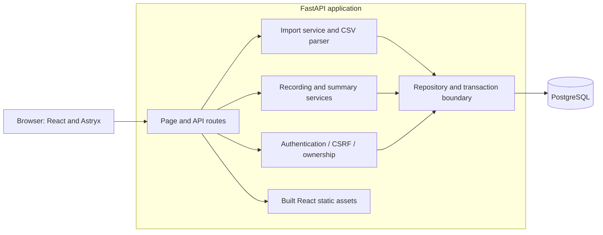
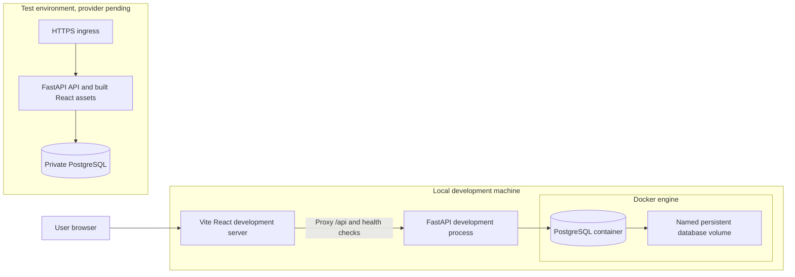
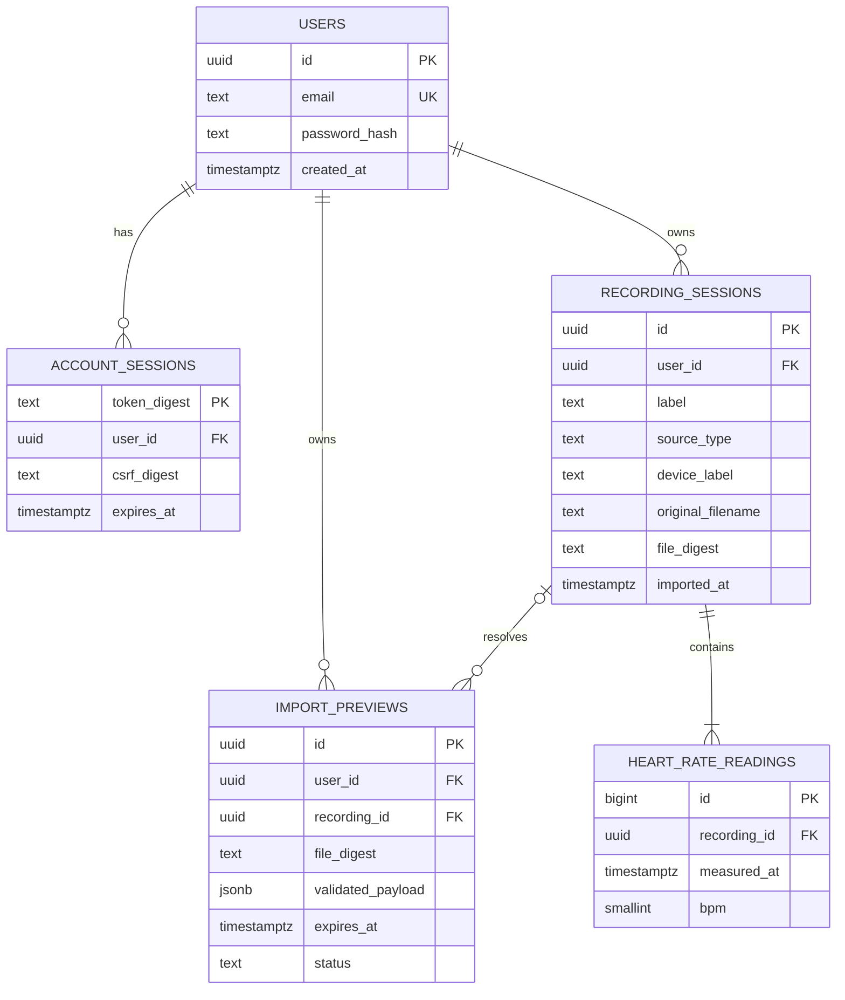

# Architecture and database design

**Status:** Architecture draft with initial schema/auth implemented locally. Alembic revision `0001_initial` has been applied to the existing PostgreSQL container. The [schema export](../backend/migrations/schema.sql) and [authentication guide](15-authentication.md) describe this increment; frontend and CSV workflows remain planned.

## Architecture decision

Use a React frontend with Astryx components and a layered FastAPI backend. React calls same-origin JSON endpoints. Backend route handlers authenticate and validate requests; application services apply import and query rules; repositories handle PostgreSQL transactions. A proposed Vite/TypeScript build produces static frontend assets. Serve those assets and `/api` under one origin in deployment to preserve the cookie/CSRF design.

The student selected React/Astryx after the initial server-rendered design. This adds a frontend build chain and component-level checks, which must be included in setup, CI and estimates. Microservices remain unnecessary. The workbook's Python/FastAPI and PostgreSQL backend stack is retained; React is the selected frontend addition.

## Component view

## Deployment view

Local database ports should bind only to loopback when exposed. Test deployment must use HTTPS, a private database connection, environment-provided secrets and migrations. Do not expose a database port publicly. Docker configuration will be written when implementation starts; no image tag or running container is assumed yet.

## Entity relationship diagram

## Schema specification for the later migration

| Table | Types, constraints and lifecycle |
| --- | --- |
| users | UUID primary key generated by the application; email stored trimmed and lowercased with UNIQUE; password_hash is non-null; created_at TIMESTAMPTZ non-null |
| account_sessions | SHA-256 digest of a random session token as primary key; user_id non-null FK; CSRF secret digest; created_at and expires_at non-null; revoke by deletion; cascade on user deletion |
| recording_sessions | UUID PK; user_id non-null FK; label trimmed length 1–100; source_type CHECK recorded/synthetic; optional device_label max 100; original_filename sanitised display metadata max 255; file_digest 64-character lowercase SHA-256 hex; imported_at non-null; UNIQUE(user_id,file_digest) |
| heart_rate_readings | BIGINT generated identity PK; recording_id non-null FK with ON DELETE CASCADE; measured_at TIMESTAMPTZ non-null; bpm SMALLINT non-null CHECK 1–300; UNIQUE(recording_id,measured_at) |
| import_previews | UUID opaque ID; user_id non-null FK; nullable recording_id FK with ON DELETE SET NULL; metadata matching recording label/source/filename/device/file digest; validated_payload JSONB only while pending; created_at/expires_at; status CHECK pending/consumed; consumed_at nullable |

Recording sessions and previews also cascade on user deletion. No account-deletion UI is included in v1. Authentication and import requests must still check expiry even if the cleanup job has not run.

Pending previews require a non-null validated payload and null recording_id/consumed_at. Consumed previews require null payload and non-null consumed_at; recording_id may be null after the recording is deleted. Reconfirming such a consumed preview returns 410 rather than re-creating a recording. Cleanup deletes expired pending previews and consumed preview metadata 24 hours after consumption. An application maintenance task runs every five minutes; its execution must be included in deployment checks.

Indexes: users.email unique; recording_sessions(user_id, imported_at DESC, id); heart_rate_readings(recording_id, measured_at, id); import_previews(user_id, expires_at); account_sessions(expires_at). Use an additional measured_at index only if query plans and the measured workload justify it. The composite recording/time uniqueness also prevents within-session duplicate instants.

## Ownership, time and calculations

Every query for readings joins the recording owner or starts from an owner-checked recording. UUIDs are identifiers, not authorisation. Preview confirmation checks both preview owner and destination recording owner.

Store measurement instants as TIMESTAMPTZ and use UTC for database sessions, API serialisation and UI labels. PostgreSQL stores these values as UTC instants; it does not retain the original input offset. The CSV contract therefore requires an offset and the preview shows the converted UTC time. Preserve neither a guessed local zone nor claims of source-zone round trips.

Compute count/min/max/mean from the full matching rows. Avoid storing mutable summary totals in v1. Overlapping imported files with different digests remain separate sessions; the all-recordings dashboard therefore describes imported rows. Show this rule in help.

## Import transaction

1. Stream and validate bounded content; do not trust the filename, MIME type or browser checks.
2. Store valid normalised rows in an owner-bound expiring preview. Limit each user to three pending previews; discard expired previews before enforcing the cap. Return 429 if the cap remains reached.
3. On confirmation, lock the owned preview, check expiry/status and look for an existing account/file digest.
4. Insert the recording and all readings within one transaction, then mark the preview consumed and clear its payload. Roll back every change if any insert fails.
5. Resolve unique-digest races through rollback/re-query so concurrent confirmations converge on the same recording. Preserve the existing recording's label/source/device metadata on duplicates and return an explicit existing-recording outcome. Never return another user's recording. Retry by consumed preview ID is guaranteed only during its 24-hour metadata retention; after cleanup return 404 and offer re-upload, which still benefits from file-digest deduplication.
6. Remove temporary raw files immediately; scheduled cleanup handles abandoned validated previews.

## Supporting dependencies and sources

Selected frontend: React with Astryx; Vite/TypeScript remain proposed frontend tooling. The backend now uses SQLAlchemy Core with Psycopg, Alembic and argon2-cffi. unittest and HTTPX exercise the current increment; Ruff supplies static checks. Installed backend versions are pinned in `backend/uv.lock`. The global Astryx CLI is tooling; runtime components and compatible theme/style dependencies still need installation in the frontend project. The auth increment adds `auth_rate_limits` to the original five-table design for database-coordinated throttling.

The frontend direction follows the official [React build-from-scratch guide](https://react.dev/learn/build-a-react-app-from-scratch), retrieved through Context7, and [Astryx documentation](https://github.com/meta/astryx). FastAPI's [static files](https://fastapi.tiangolo.com/tutorial/static-files/) and [file uploads](https://fastapi.tiangolo.com/tutorial/request-files/) documentation support static-asset delivery and multipart import. The storage design follows PostgreSQL's [date/time types](https://www.postgresql.org/docs/current/datatype-datetime.html) and [constraints](https://www.postgresql.org/docs/current/ddl-constraints.html). These support design choices; they are not evidence of implementation.
